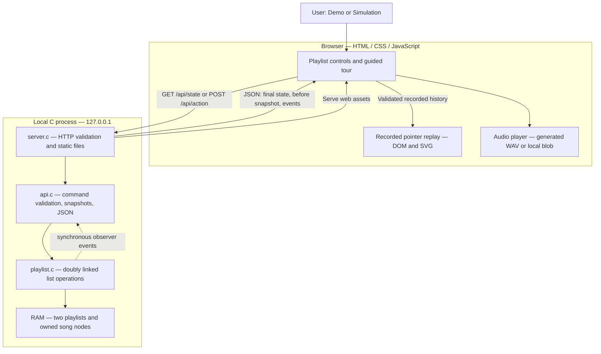

# Musiclab — Records & Pointers

**A music playlist manager and doubly linked list visualizer built with C, HTML, CSS, and JavaScript.**

Musiclab connects a familiar problem—moving forward and backward through a playlist—to the pointer operations taught in Data Structures and Algorithms. C owns every node and performs every list operation. The browser presents the playlist, plays optional audio previews, and visualizes events recorded by the C implementation.

The project is intended for a second-year DSA demonstration and repository submission. It runs locally on Linux or Windows through WSL without a framework, database, or runtime npm dependencies.

## Contents

- [Objectives and features](#objectives-and-features)
- [Build and run](#build-and-run)
- [Architecture](#architecture)
- [Data structure and algorithms](#data-structure-and-algorithms)
- [Repository structure](#repository-structure)
- [Testing](#testing)
- [Limitations](#limitations)
- [Documentation](#documentation)

## Objectives and features

The learning objectives are to implement a doubly linked list manually, explain allocation and ownership, demonstrate actual pointer changes, and validate list invariants after complete operations.

| Area | What it provides |
| --- | --- |
| Two playlists | Side A (`main`) and Side B (`secondary`), with add, select, delete, navigation, reverse, and merge |
| Demo view | Manual controls, explicit Play/Pause, volume, generated sample melodies, and optional local audio |
| Simulation view | Silent replay of actual C allocations, ID comparisons, pointer assignments, and frees |
| Guided tour | Eight sequential C actions with Start, Pause/Resume, Stop, speed, and progress |
| Replay controls | Previous/next frame, replay, finish, speed, and automatic playback |
| Presentation | Responsive layout, labelled controls, status messages, and reduced-motion behavior |
| Validation | Native C, trace, HTTP/API, frontend unit, sanitizer, and optional real-browser checks |

Generated melodies are 12-second sample tones, **not recordings of the named songs**. Local audio stays in the browser and is never uploaded to C.

## Build and run

### Requirements

| Tool | Requirement |
| --- | --- |
| Operating system | Linux, or Windows using WSL |
| C toolchain | C11 compiler and GNU Make; GCC is a suitable default |
| Browser | A modern browser with JavaScript enabled |
| Node.js | 18+ for validation; CI uses Node.js 22 |
| Playwright | Optional for browser tests; version 1.56.1 |

On Ubuntu/WSL, install missing build tools with `sudo apt-get install build-essential`. Node.js is unnecessary for simply running the app.

```sh
git clone https://github.com/Rajveerx11/DSAProject.git
cd DSAProject
make
./build/musiclab --port 8081
```

Open `http://localhost:8081` in your local browser. Keep the terminal running and stop the server with **Ctrl+C**. Run the binary from the repository root so it can find `web/`. The default port is 8080 when `--port` is omitted. For an existing checkout, enter its directory and skip cloning.

From Windows PowerShell, if the checkout is at `C:\DSAProject`, run these separately:

```powershell
wsl.exe --cd /mnt/c/DSAProject -- make
wsl.exe --cd /mnt/c/DSAProject -- ./build/musiclab --port 8081
```

Or double-click **`start.bat`**: it builds in WSL, picks a free temporary port, starts the server in its own window (close it to stop), and opens `http://127.0.0.1:<port>/`. It uses `127.0.0.1` rather than `localhost` because WSL forwards IPv4 only, and some browsers resolve `localhost` to IPv6 `::1`.

### First walkthrough

1. In **Demo**, select a Side A record and press **Play**. Add your own record, optionally attaching a supported local audio file.
2. Use **Next**, **Previous**, and **Reverse A** to explore playlist behavior.
3. Open **Simulation**, then press **Start →** for the guided tour. **Start replaces both playlists with sample data.**
4. Open **Manual replay controls** to inspect individual assignments. The collection shows committed C state; the diagram can show earlier frames.

Navigation between views preserves server state. Initial state contains three records in Side A and two in Side B. See the [demonstration guide](docs/DEMONSTRATION.md) for a ten-minute presentation and viva questions.

### Troubleshooting

| Symptom | What to check |
| --- | --- |
| `cc` or `make` not found | Install the C toolchain and Make inside Linux/WSL |
| `listen/bind: Address already in use` | Choose another port, e.g. `--port 8082`; use the same port in the browser |
| API works but page/assets return 404 | Start from the repository root, where `web/` exists |
| Opening `index.html` does not connect | Use the C server; opening a file directly does not provide the API |
| No sound | Use Demo, select Side A, press Play, check volume, and try a supported audio format |
| State disappeared | Server restart/reset replaces playlists; reload discards browser-local audio associations |

## Architecture



`server.c` handles local HTTP requests, `api.c` translates accepted commands into list operations, and `playlist.c` changes the pointers. A synchronous observer captures events at the actual C operations. The API returns committed state together with an owned before snapshot and event sequence.

JavaScript projects those events into diagram frames. It does not perform the backend insertion, deletion, reverse, or merge. C has already committed before replay starts; intermediate frames are historical and can temporarily contain incomplete or cyclic links. The final top-level playlist snapshot is authoritative.

See [architecture and ownership](docs/ARCHITECTURE.md) for a request sequence, module responsibilities, and design decisions. GitHub renders the Mermaid diagram above; readers without Mermaid support can follow the same module flow in this description.

## Data structure and algorithms

The node declaration in [src/playlist.h](src/playlist.h) is:

```c
typedef struct SongNode {
    uint32_t id;
    char title[SONG_TEXT_BYTES + 1];
    char artist[SONG_TEXT_BYTES + 1];
    struct SongNode *prev, *next;
} SongNode;
```

Each `Playlist` maintains `head`, `tail`, `current`, and `size`, plus an optional observer and its context. `SONG_TEXT_BYTES` is 127. IDs are logical identifiers, not memory addresses, and are never reused within a server process, including after reset.

```text
head ──► [record 1] ◄──► [record 2] ◄──► [record 3] ◄── tail
          prev=NULL       ▲               next=NULL
                          current
```

### Complexity

Let *n* be the number of records involved. These are the underlying linked-list costs:

| Operation | Time | Reason |
| --- | --- | --- |
| Append | O(1) | Maintained tail avoids traversal |
| Next / Previous | O(1) | Follow one adjacent link |
| Search / Select by ID | O(n) | Compare IDs while traversing |
| Delete by ID | O(n) | Search is O(n); unlinking a found node is O(1) |
| Reverse | O(n) | Exchange each node's links and the endpoints |
| Concatenate / Merge | O(1) | Connect endpoints and transfer ownership |
| Display / Clear | O(n) | Visit or free every node |

Nodes use O(n) space; the pointer algorithms use O(1) auxiliary space. Educational snapshots and traces add storage proportional to records/events. Full API responses serialize both playlists and trace data, so an O(1) pointer mutation still has an O(n) request/response cost.

### Behavior and invariants

- Empty lists have `head == tail == current == NULL` and size zero.
- Nonempty lists have `head->prev == NULL`, `tail->next == NULL`, reciprocal neighbor links, correct size, and a current node belonging to that list.
- First insertion sets head, tail, and current. Navigation stops at boundaries without wrapping.
- Deleting current selects its next node, otherwise its previous node, otherwise NULL.
- Reverse preserves the selected node. Merge moves existing nodes, empties the source, and preserves destination current unless the destination was empty.
- The app accepts at most 200 songs across both lists. Title and artist must each contain 1–127 UTF-8 bytes after ASCII edge-space trimming, without control characters.

## Repository structure

```text
DSAProject/
├── src/
│   ├── playlist.h / playlist.c   # Nodes, algorithms, ownership, observers
│   ├── api.h / api.c             # Commands, snapshots, traces, JSON
│   └── server.c                 # Loopback HTTP and static asset adapter
├── web/
│   ├── index.html / styles.css  # Views, controls, responsive styling
│   ├── app.js                   # API client, replay, guided tour, audio
│   ├── check.cjs                # Frontend unit/contract checks
│   └── favicon.svg
├── tests/
│   ├── native.c / trace.c       # List invariants and trace correctness
│   ├── api.mjs                  # HTTP/API integration and negative cases
│   └── browser*.cjs             # Browser flows and owned-server runner
├── docs/                       # Architecture, testing, demonstration
├── .github/workflows/validate.yml
├── Makefile
└── README.md / API.md / SIMULATION.md / GUIDED_DEMO.md / PLAN.md
```

`build/` is generated and ignored by Git. See [CONTRIBUTING.md](CONTRIBUTING.md) for development guidance.

## Testing

Run from the repository root:

```sh
make check       # C build, native + trace + API tests, JS syntax and unit checks
make sanitize    # Native + trace + API with ASan, UBSan, and leak detection
```

Real-browser validation uses optional Playwright tooling installed outside the checkout. Setup, individual targets, coverage, and troubleshooting are in [docs/TESTING.md](docs/TESTING.md). CI runs all three layers on Ubuntu; this describes the workflow, not the result of any particular CI run.

## Limitations

- The server is a serial, loopback-only classroom application with shared process state, no accounts, and no multi-user isolation. It is not intended for public deployment.
- Playlists are not persisted. Restarting the server loses changes; reset replaces both lists with sample data.
- Audio is browser-only. Reload or a real page exit discards local file associations; a back/forward-cache return can retain them but stays paused. There is no upload, internet streaming, or audio storage in C.
- Simulation is recorded C history, not live CPU debugging. Another tab's changes appear after **Refresh state**.
- Native Windows, macOS, production hosting, and database integration are outside the supported workflow.

## Documentation

| Document | Purpose |
| --- | --- |
| [Architecture](docs/ARCHITECTURE.md) | Module boundaries, request sequence, ownership, design decisions |
| [API reference](API.md) | Endpoints, fields, examples, errors, and transport limits |
| [Simulation](SIMULATION.md) | Trace events, replay frames, invariants, and rendering |
| [Guided demo](GUIDED_DEMO.md) | Views, eight-step controller, pause/stop, audio lifecycle |
| [Testing](docs/TESTING.md) | Reproducible commands, coverage, CI, and diagnostics |
| [Demonstration](docs/DEMONSTRATION.md) | Submission checklist, presentation script, viva questions |
| [Project scope](PLAN.md) | Objectives, implemented scope, and possible future work |
| [Contributing](CONTRIBUTING.md) | Local development and change-review guidance |
