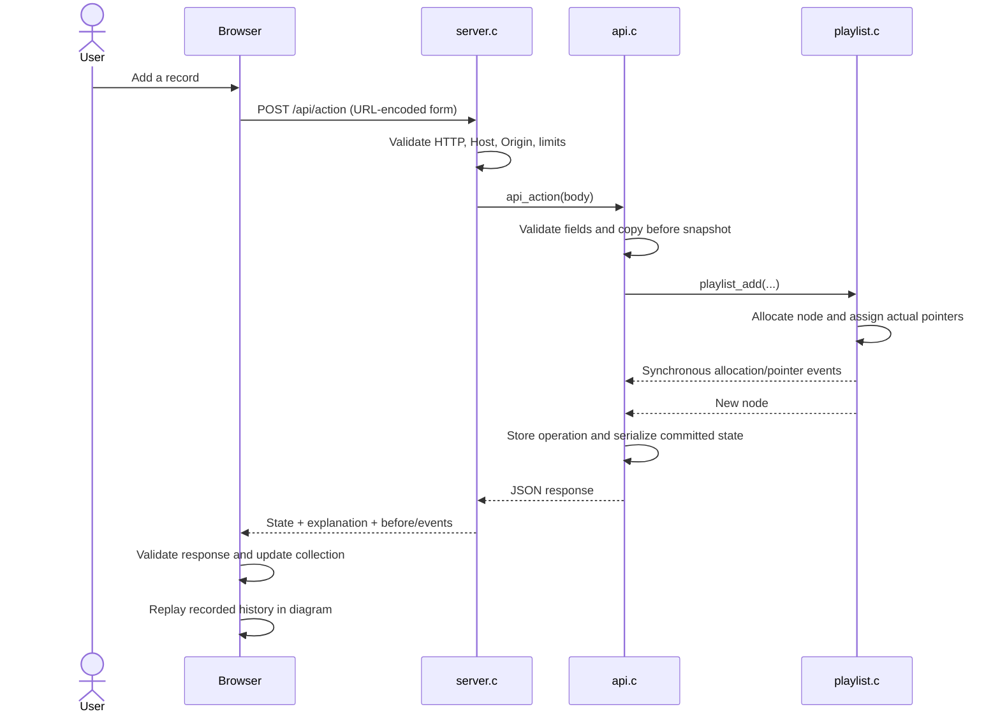

# Architecture and Design

[Back to README](../README.md)

Musiclab has one local C process and one browser application. C is the authority for playlist metadata, ordering, selection, and node lifetime. The browser owns presentation, replay position, guided scheduling, and audio resources.

## Module responsibilities

| Module | Responsibility | Boundary |
| --- | --- | --- |
| `src/playlist.h`, `src/playlist.c` | Types, UTF-8 text policy, pointer algorithms, synchronous observer | No HTTP or browser code |
| `src/api.h`, `src/api.c` | App state, IDs, action validation, snapshots, trace capture, JSON | Calls list functions; does not duplicate their algorithms |
| `src/server.c` | Loopback socket, HTTP validation, endpoint dispatch, static allowlist, shutdown | Serial adapter for local use |
| `web/index.html`, `web/styles.css` | Controls, views, responsive layout, diagram and tour styling | No server-side state |
| `web/app.js` | Fetch/validation, DOM/SVG projection, replay, routing, tour, audio | Consumes C state/events; never owns backend nodes |

## One mutation, end to end

Replay is local display work. Clicking Replay sends no mutation request. A new operation finishes the previous visual replay before requesting fresh C state.

## Data model and ownership

`App` holds two `Playlist` structures, the next process-wide ID, and the latest `Operation`. Each playlist owns its allocated `SongNode` objects. Endpoints, current, and neighbor pointers refer to those same objects.

- **Add:** allocate one node, copy validated metadata, link it at the tail, and select it if the list was empty.
- **Delete:** find once, update current/endpoints/neighbors, emit the free event, and free the node.
- **Reverse:** save each original next pointer, swap links, then swap endpoints. Current still refers to the same node.
- **Merge:** splice existing source nodes onto the destination; clear source endpoints/current/size to transfer ownership without double-freeing.
- **Clear/shutdown:** retain the next pointer before freeing each node. Normal server shutdown calls application cleanup.

The API assigns positive 32-bit IDs and uses a wider next-ID counter to detect exhaustion. IDs are not reused after reset within the process. Restarting begins a new ID lifetime.

## Observer and trace design

`PlaylistObserver` is optional, synchronous, and read-only. Pointer events capture old and new IDs at the actual assignment; visits occur immediately before ID comparison. Events copy IDs and allocation metadata rather than retaining freed node addresses. Callbacks must not mutate or reenter the list.

The API owns snapshots and captured events, so serialization does not require dereferencing deleted nodes. JavaScript stores a projection indexed by logical IDs. This can display temporary cycles or cross-list links during reversal/merge without traversing an invalid intermediate list. See [SIMULATION.md](../SIMULATION.md) for frame semantics.

## State lifetimes

| State | Owner | Lifetime |
| --- | --- | --- |
| Nodes, order, current | C process | Until deletion, reset, or server exit |
| Latest operation and before/events | C API | Replaced by the next accepted operation |
| Replay frame and guided timers | Browser | Current operation/tour/page |
| Local audio and blob URLs | Browser | Until removal/reset/reload/real page exit; cached Back can retain them |

All tabs share C state. **Refresh state** retrieves changes made elsewhere; there is no push channel or per-user session. A GET can return the last operation's reset label without being a new reset.

## Design decisions

| Decision | Rationale / tradeoff |
| --- | --- |
| Doubly linked list | O(1) previous/next from current, at the cost of an extra pointer per node |
| Maintained tail | O(1) append and concatenation |
| C backend, plain JavaScript frontend | Explicit pointer manipulation with browser controls and graphics |
| Full response snapshots | Simple consistency checks, with O(n) serialization even for constant-time mutations |
| Serial local HTTP server | Small, inspectable transport; unsuitable for public multi-user workloads |
| Browser-only audio | No upload/storage integration; associations are session-local |
| Explicit tour reset | Predictable initial state with a visible replacement warning |

## Transport boundaries

The server binds IPv4 loopback, validates local Host and browser mutation origin, closes each HTTP connection, and serves an exact static-path allowlist. Request sizes and read time are bounded. JSON is escaped and responses include a content security policy.

These controls support local demonstration. They do not add authentication, persistence, TLS termination, concurrent sessions, or production hosting. Exact routes, errors, and limits are in [API.md](../API.md).
